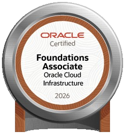
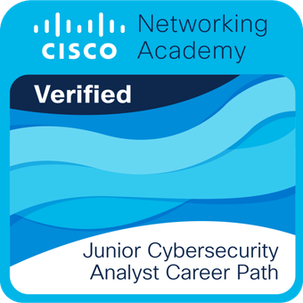

# Nicolau

`Linux & DevOps` `Cloud · OCI Certified` `Java & C#`

Profissional de infraestrutura com foco em servidores Linux, automação e nuvem. No dia a dia, administro servidores, automatizo rotinas com scripts Bash (como a gestão de logs de serviços Apache e PostgreSQL) e publico aplicações em containers Docker em uma instância Ubuntu na Oracle Cloud.

Sou certificado em **Oracle Cloud Infrastructure** e estou direcionando minha carreira para **DevOps e Cloud**: os próximos passos são o OCI Architect Associate e, depois, o OCI DevOps Professional, junto com Kubernetes e Terraform.

Também desenvolvo em Java e C#/.NET. Meu principal projeto hoje é o [projeto-ibitipoca](https://github.com/nicolaudev-hub/projeto-ibitipoca), um sistema de navegação offline com rotas calculadas via OSRM, mapa em Leaflet e tiles servidos por TileServer GL. Gosto de construir de forma incremental: primeiro funcionando, depois evoluindo a arquitetura.

---

### 🧰 Linguagens e Ferramentas

  
  
  
  
  
  
  
  
  
  
  
  

  
  

